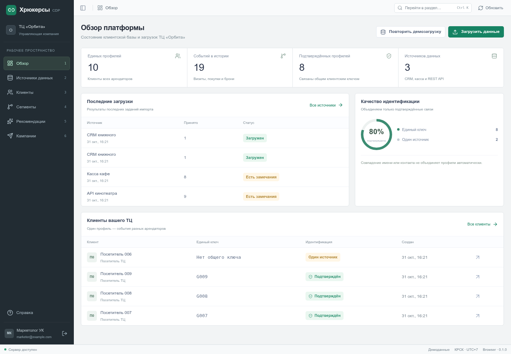
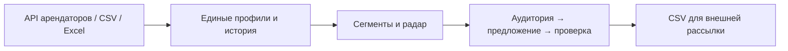

<div align="center">


# NEXA

### От данных арендаторов — к персональным предложениям

Единая клиентская платформа торгового центра · **Команда «Хрюкерсы»** · **СибКод, кейс №2**

**Linux & Windows** · Tauri 2 · React · FastAPI · PostgreSQL

[Возможности](#возможности) · [Быстрый запуск](#быстрый-запуск) · [Desktop](#desktop-приложение) · [Документация](#документация)

</div>



## Зачем NEXA

У каждого арендатора своя клиентская база. Управляющая компания видит отдельные записи, но не общую историю взаимодействий человека с торговым центром.

**NEXA объединяет эти данные и помогает маркетологу выбрать, кого, куда и с каким предложением пригласить.** От подключения источников до подготовки аудитории для рассылки — в одном рабочем пространстве.



## Возможности

| Функция | Что даёт пользователю |
|---|---|
| **Автоматические интеграции** | Получение новых записей из API по расписанию, ручное обновление, контроль свежести и ошибок |
| **CSV и Excel** | Загрузка истории, проверка структуры и понятные причины отклонения строк |
| **Единый профиль** | Объединение по телефону или email и общая лента взаимодействий с арендаторами |
| **Полнота истории** | Явный период покрытия: недостаток данных отображается как неопределённость |
| **Динамические сегменты** | Условия включения и исключения, окно истории, пересчёт по актуальным событиям |
| **Радар новых визитов** | Карта связей арендаторов, пересечения аудиторий и объяснение возможностей для приглашения |
| **Рекомендации** | Связь аудитории с действующим предложением, назначением и приоритетом |
| **Мастер кампании** | Три шага: аудитория → предложение → проверка Email/SMS-контактов |
| **Выгрузки** | Предпросмотр получателей, причины исключений, CSV и ограничение повторных выгрузок |
| **Кабинет бренда** | Сопоставление колонок своей таблицы, предпросмотр и журнал загрузок своего магазина |

### Для кого

| Роль | Рабочие задачи |
|---|---|
| **Маркетолог** | Профили, сегменты, радар, рекомендации, кампании и выгрузки |
| **Администратор** | Задачи маркетолога, подключение арендаторов, полнота истории и сотрудники |
| **Представитель бренда** | Передача данных и просмотр загрузок только своего магазина |

Права проверяются сервером. Общая клиентская база ограничена текущим ТЦ и закрыта от представителей брендов.

### Минимум данных — понятные выводы

Все новые источники используют **телефон, email и время взаимодействия**. Время обязательно; достаточно одного корректного контакта. Названия колонок в кабинете бренда можно сопоставить вручную.

```csv
phone,email,time
+79131234567,visitor@example.invalid,2026-10-30T12:00:00+07:00
,another@example.invalid,2026-10-30T12:15:00+07:00
```

Совпадение контакта — правило сопоставления профилей. Конфликтующие контакты отклоняются, повторы не дублируют события. Полнота истории задаётся явно и не выводится из крайних дат файла.

> По этим полям фиксируется взаимодействие. Покупка и физический маршрут посетителя не определяются. Радар показывает наблюдаемые связи аудиторий; CSV-выгрузка сама не отправляет сообщения.

## Быстрый запуск

Нужны **Docker Engine и Docker Compose**. На Windows — Docker Desktop с Linux containers. Команды выполняются из корня репозитория.

**Для нового клона:**

```bash
git clone https://github.com/skrudje/sibcode-hackathon.git
cd sibcode-hackathon
cp .env.example .env
docker compose up --build -d --wait
```

В PowerShell вместо `cp` можно использовать `Copy-Item`. Если `.env` уже настроен, сохраните его и выполните только команду запуска.

**Открыть в браузере: [http://localhost:5180](http://localhost:5180).**

<details>
<summary><strong>Учётные записи локального примера</strong></summary>

| Роль | Email | Пароль |
|---|---|---|
| Маркетолог | `marketer@example.com` | `HryukersDemo2026!` |
| Администратор | `admin@example.com` | `HryukersAdmin2026!` |

Это публичные значения только для локального стенда. Шаблон явно включает `SEED_DEMO_ACCOUNTS=true`; без него известные аккаунты не создаются. Для первого собственного администратора задайте уникальные `ADMIN_EMAIL` и `ADMIN_PASSWORD` длиной от 12 символов. Изменение env не меняет уже сохранённые пароли.

</details>

В локальном примере подготовлены **9 вымышленных арендаторов, около 600 клиентов и несколько тысяч взаимодействий**. Начальная обработка занимает несколько минут и видна в журнале загрузок. `SEED_WORKSPACE_DATA=false` отключает добавление этого набора. Перезапуск сохраняет существующую историю.

### Попробовать за пять шагов

1. Войдите и откройте профиль клиента: посмотрите контакты и историю.
2. В **радаре** выберите связь арендаторов и изучите объяснение аудитории.
3. Перейдите в **мастер кампании**, выберите предложение и канал.
4. Проверьте получателей и причины исключений, затем сформируйте **CSV**.
5. Добавьте новое взаимодействие целевого арендатора и посмотрите, как изменится состав сегмента.

Реальные CRM и сервисы отправки в локальном примере не подключены. Для настоящего API нужны адрес и доступ арендатора.

## Desktop-приложение

NEXA — настольный клиент для **Linux и Windows**. Интерфейс упакован локально, данные и расчёты находятся на общем сервере. Установленному клиенту не нужны Node.js, Python и Rust.

Для разработки установите зависимости Tauri по [инструкции](docs/DESKTOP.md), запустите сервер через Compose и выполните:

```bash
cd apps/web
npm ci
npm run desktop:dev
```

Сборка установщика на выбранной ОС:

```bash
npm run desktop:build
```

Настройки сервера, native-сессия, системное сохранение CSV и особенности установки описаны в [DESKTOP.md](docs/DESKTOP.md).

## Как устроен проект

| Слой | Технологии и назначение |
|---|---|
| Desktop | Tauri 2, Rust: подключение к серверу, хранение сессии в памяти, системный диалог сохранения |
| Интерфейс | React, TypeScript, Vite, Tailwind, Radix Dialog, TanStack Query |
| API | FastAPI, Pydantic, SQLAlchemy и Alembic |
| Хранение | PostgreSQL 18: профили, события, задания и результаты обработки |
| Фоновая работа | Valkey/RQ, worker и dispatcher: очередь, расписание и восстановление заданий |
| Развёртывание | Docker Compose и Nginx; API, worker и dispatcher используют общее модульное ядро |

### Структура репозитория

```text
apps/
  api/                 Backend, миграции, тесты и fixtures
  web/                 Интерфейс, Tauri-клиент и пользовательские тесты
docs/
  api/openapi.json     Единый актуальный API-контракт
  ...                  Бизнес-логика и инструкции
infra/                 Docker, Nginx и проверки безопасности
.github/workflows/     CI и сборка установщиков
compose.yaml           Локальный серверный стенд
```

OpenAPI описывает **54 операции**. TypeScript-типы генерируются из этого контракта; примеры данных находятся в `apps/api/fixtures`.

## Документация

| Задача | Где читать |
|---|---|
| Понять функциональность и бизнес-логику | [Продуктовый бриф](docs/CREATIVE_BRIEF.md) |
| Подключить API и настроить роли | [Интеграции](docs/INTEGRATIONS.md) |
| Подготовить файл или задать полноту | [Форматы импорта](docs/IMPORT_FORMATS.md) |
| Разобраться в объединении профилей | [Идентификация](docs/IDENTITY.md) |
| Изучить расчёт связей | [Радар](docs/RADAR.md) |
| Создать кампанию | [Мастер кампании](docs/CAMPAIGN_WIZARD.md) |
| Передать данные от магазина | [Кабинет бренда](docs/BRAND_PORTAL.md) |
| Запустить и собрать desktop | [Linux и Windows](docs/DESKTOP.md) |
| Работать над проектом вместе | [Командная разработка](docs/TEAM.md) |
| Посмотреть выполненные проверки | [Проверки MVP](docs/VERIFICATION.md) |

## Разработка и эксплуатация

<details>
<summary><strong>Frontend и генерация типов</strong></summary>

```bash
cd apps/web
npm ci
npm run generate:api
npm run build
```

Для frontend-разработки запустите API на 8010 и `npm run dev`: Vite проксирует `/api`. Не запускайте Vite и web-контейнер одновременно на 5180.

</details>

<details>
<summary><strong>Backend-тесты и изоляция данных</strong></summary>

Нужны Python ≥3.13, отдельная PostgreSQL-база с суффиксом `_test` и Redis/Valkey DB 15. Передайте `TEST_DATABASE_URL` и `TEST_REDIS_URL`; по умолчанию используются PostgreSQL на 55432 и `redis://localhost:56380/15`. Пользователь тестовой БД должен иметь CREATEDB.

```bash
python3 -m venv .venv
.venv/bin/pip install -e 'apps/api[test]'
.venv/bin/pytest -q apps/api/tests
```

Рабочая база не используется. Проверяются права и границы ТЦ, идентификация, адаптеры, качество файлов, полнота, сегменты, восстановление обработки и конкурентные выгрузки.

</details>

<details>
<summary><strong>Браузерные E2E</strong></summary>

Только отдельный Compose-проект `hryukers-e2e`, со своими volumes и портами:

```bash
cp .env.e2e.example .env.e2e
docker compose -p hryukers-e2e --env-file .env.e2e up --build -d --wait
cd apps/web
npx playwright install chromium
npm run test:e2e
```

Существующую `.env.e2e` сохраняйте. Дождитесь начальной обработки данных. Playwright обращается к 5181; адрес можно изменить через `E2E_BASE_URL`. Native/IPC-проверки описаны в [DESKTOP.md](docs/DESKTOP.md).

</details>

<details>
<summary><strong>Остановка, возобновление и логи</strong></summary>

Из корня репозитория:

```bash
docker compose down
docker compose up -d --wait
docker compose ps
docker compose logs --tail=100 api worker dispatcher
```

Обычная остановка сохраняет данные в named volumes. **`docker compose down -v` удаляет базу, загрузки и историю выгрузок этого проекта.** Для очистки тестового стенда используйте только его имя: `docker compose -p hryukers-e2e --env-file .env.e2e down -v`.

</details>

<details>
<summary><strong>Безопасность и серверное развёртывание</strong></summary>

- В Git хранятся только публичные `.env.example` и `.env.e2e.example`. Реальные доступы, ключи, базы, выгрузки и локальные артефакты исключены из Git и Docker context.
- Для сервера: `DEPLOYMENT_MODE=production`, `SEED_DEMO_ACCOUNTS=false`, `SEED_WORKSPACE_DATA=false`, `COOKIE_SECURE=true`, HTTPS в `ALLOWED_ORIGINS`, собственные пароли БД и администратора. TLS настраивается на внешнем прокси.
- Перед переходом в production создайте собственную учётную запись администратора и отключите аккаунты с публичными паролями. Проверка конфигурации и сохранённых аккаунтов блокирует небезопасный запуск.
- Токены API хранятся в серверных `CONNECTOR_SECRET_*`. Их назначение ТЦ, арендатору и origin задаётся в `CONNECTOR_SECRET_BINDINGS`; [пример настройки](docs/INTEGRATIONS.md).
- Вход и загрузки ограничены по частоте. По умолчанию: 3 активных импорта на источник, 20 на ТЦ, 256 MiB входных файлов на ТЦ, 1 GiB суммарно. Настройки: `MAX_ACTIVE_IMPORTS_PER_SOURCE`, `MAX_ACTIVE_IMPORTS_PER_MALL`, `MAX_UPLOAD_BYTES_PER_MALL`, `MAX_UPLOAD_BYTES_TOTAL`.
- Входные файлы завершённых заданий очищаются через `IMPORT_FILE_RETENTION_HOURS` (24 часа). Активные задания, события и результаты строк сохраняются.
- CI проверяет чистоту репозитория, историю секретов и зависимости Python/JS/Rust. Совместимый патч GLib для GTK3 сохраняет лицензию upstream и проверяется по содержимому.

Проверка перед отправкой:

```bash
python3 infra/check_repository.py
```

</details>

---

<div align="center">

**NEXA · Команда «Хрюкерсы» · СибКод / Школа 21**

</div>
