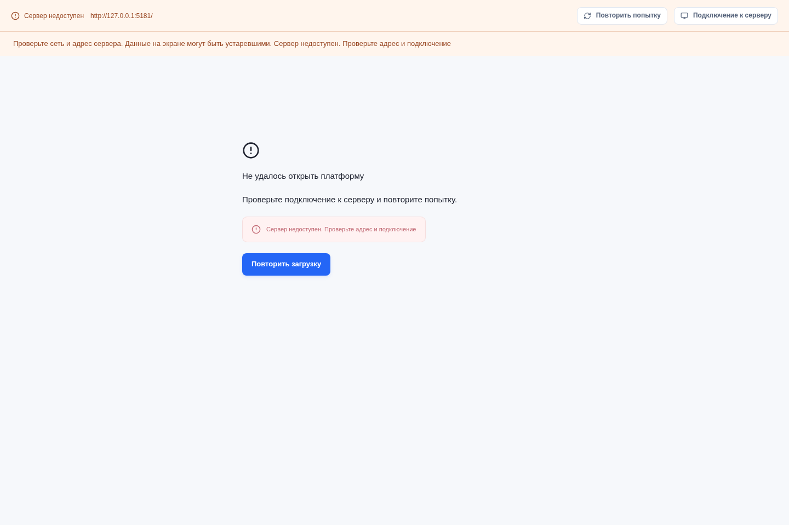
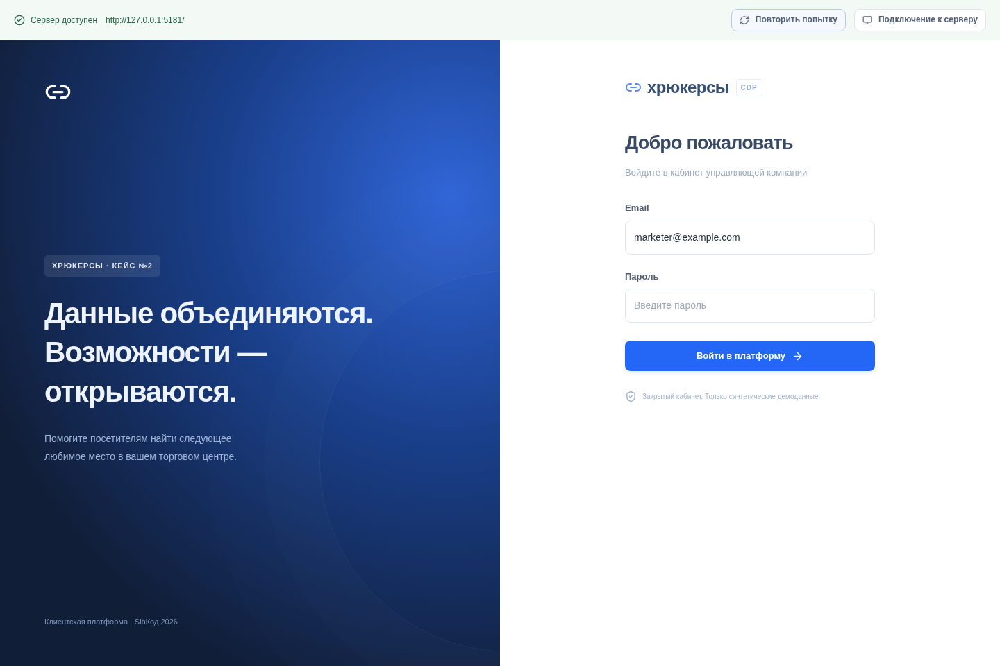
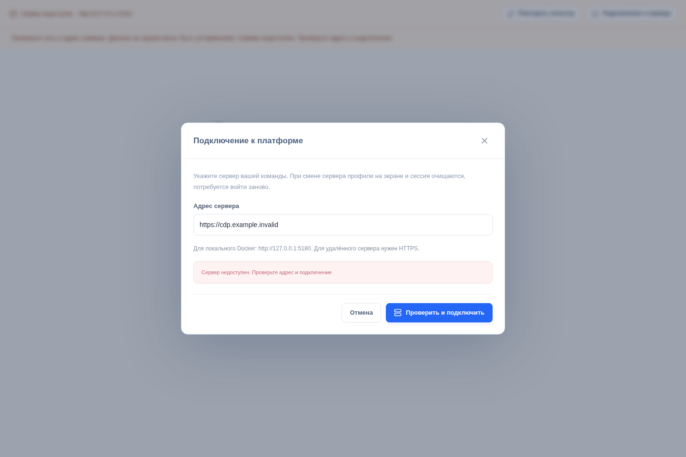

# Desktop: результаты подготовки, 31 октября 2026

Ветка: `feat/desktop-workflow`. База: `d63c6b6`. По уточнениям владельца задачи ручная проверка Windows исключена; для Linux подготовлен сценарий без установки системных зависимостей; результат сохраняется локально с описанием PR.

## Среда и фактически выполненные проверки

ОС: Kali GNU/Linux Rolling 2025.2, x86_64; kernel 6.12.25-amd64. Node.js 24.22.1, npm 12.2.1; Chromium 136.0.7103.113. Скриншоты: headless Chromium, 1440×960, Vite 8.3.5, изолированный IPC-адаптер. Это **не снимки установленного Tauri-приложения** и не подтверждение доступности реального backend.

| Проверка | Результат | Что подтверждено |
|---|---|---|
| `npm ci` | PASS | 115 пакетов, lock-файл сохранён |
| `npm run generate:api` и отсутствие diff типов | PASS | Согласованность с текущим OpenAPI; контракт backend не менялся |
| `npm run build` | PASS | TypeScript и production-сборка Vite |
| `npm run test:desktop:ui` с `E2E_BROWSER_PATH=/usr/bin/chromium` | PASS, 2 теста | Недоступность, повторная попытка, переход к входу при 401, ошибка смены адреса и сохранение текущего адреса |
| `npm run test:desktop -- --list` | PASS | Раннер обнаруживает новый сценарий с реальным API; это не выполнение сценария |
| `git diff --check` | PASS | Нет ошибок пробелов |
| Rust format/tests, сборка установщика | NOT RUN | Нет Rust и GTK/WebKit dev-пакетов; системное окружение по уточнению пользователя не устанавливалось |
| Реальный API: полный desktop-сценарий | NOT RUN | Нет Docker/Compose; тестовая база не запускалась и рабочая база не изменялась |
| Установка `.deb`, AppImage, native-файловые диалоги | NOT RUN | Сейчас запрошена подготовка Linux-проверки; чек-лист в DESKTOP.md |
| Windows | OUT OF SCOPE | По уточнению пользователя не проверяется |

Установку JS-зависимостей пришлось дождаться из-за медленной загрузки пакетов. Для UI-тестов локальный Vite и headless Chromium запускались вне ограничений песочницы. Системные библиотеки не менялись. Временная загрузка Rust остановлена после уточнения объёма Linux-проверки.

## Изменённое поведение

- Постоянная панель подключения показывает адрес, проверку, доступность и недоступность. Проверка readiness и начальной сессии имеет native-таймаут 8 секунд; readiness повторяется каждые 30 секунд и после ошибки транспорта. Есть ручная повторная попытка и восстановление ошибочных запросов страниц.
- Ошибка получения начальной сессии показывает состояние подключения; форма входа появляется при 401. Ответ API с нестандартным JSON ошибки не ломает обработку.
- Смена сервера создаёт отдельную cookie jar. Старые IPC-команды и ответы отклоняются по номеру подключения. Перед переключением страницы скрываются, запросы отменяются; после успеха очищается кэш и перезагружается webview с `#/`. Неудачная проверка нового адреса сохраняет прежний native-клиент. Проверка того же адреса сохраняет вход.
- Отмена системного сохранения CSV получает отдельное сообщение. Доступна повторная загрузка той же выгрузки; desktop-кнопка не содержит браузерной ссылки скачивания. Серверная выгрузка и cooldown сохраняются при отмене файла.
- CSV/XLSX заранее проверяются на лимит 10 MiB; серверные проверки формата и содержимого сохранены. Выбор файла блокируется также на время демоимпорта.
- Карточка источника показывает оба конца периода полноты и покрытые типы событий. Даты берутся из API, а не из наблюдаемых событий.

## Скриншоты UI/IPC

Состояния подключения задаёт тестовый адаптер; реальные профили и контакты на снимках отсутствуют.

## Ограничения и следующий прогон

Полный сценарий **в установленном приложении не подтверждён**. Перед использованием требуется выполнить [приёмку Linux](DESKTOP.md#приёмка-установленного-приложения-на-linux), включая вход, навигацию, импорт CSV/XLSX, системный диалог сохранения/отмены, смену сервера, перезапуск, X11/Wayland и масштаб экрана ноутбука. Подготовлены Rust-регрессии для изоляции cookie и отклонения старого номера подключения, но они ещё не исполнялись в этом окружении.

Сценарий `tests/desktop/workflow.spec.ts` обращается к реальным маршрутам API, использует отдельные cookie jars и ожидает чистый Compose-проект `hryukers-e2e`. Сам файловый диалог в этом тесте моделируется. Он также ещё не выполнялся; не следует считать перечисление тестов интеграционной проверкой.

Редактор периода полноты и типов событий зависит от API коллеги. В доступных `origin/main` и OpenAPI есть `GET /sources`, импорт и sync, но нет операции обновления настроек источника. До готовности согласованного контракта редактор не реализован. План подключения и проверок записан в DESKTOP.md.

Windows job для этой ветки не запускался; прежняя успешная сборка из DESKTOP.md относится к другому коммиту. Подпись, автообновление, удалённый сервер HTTPS и настройки корпоративной сети также этим прогоном не проверялись.

Публикация ветки недоступна без GitHub-авторизации (`git push --dry-run` вернул `could not read Username for https://github.com`). По последнему указанию пользователя изменения и описание PR сохранены локально: [DESKTOP_PR.md](DESKTOP_PR.md).
